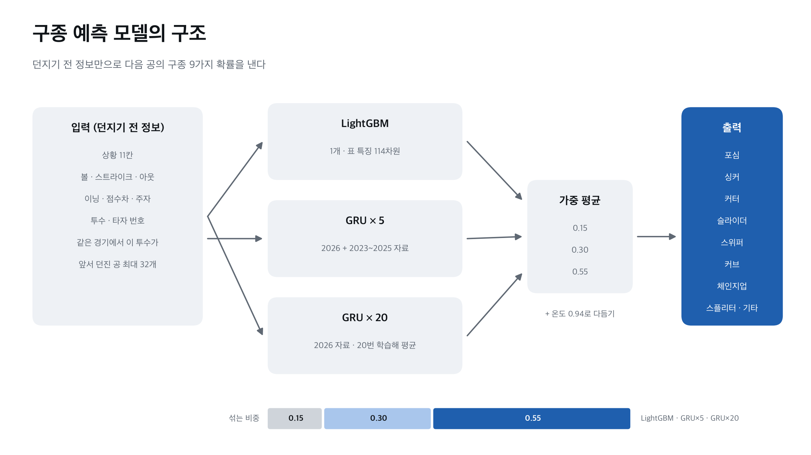
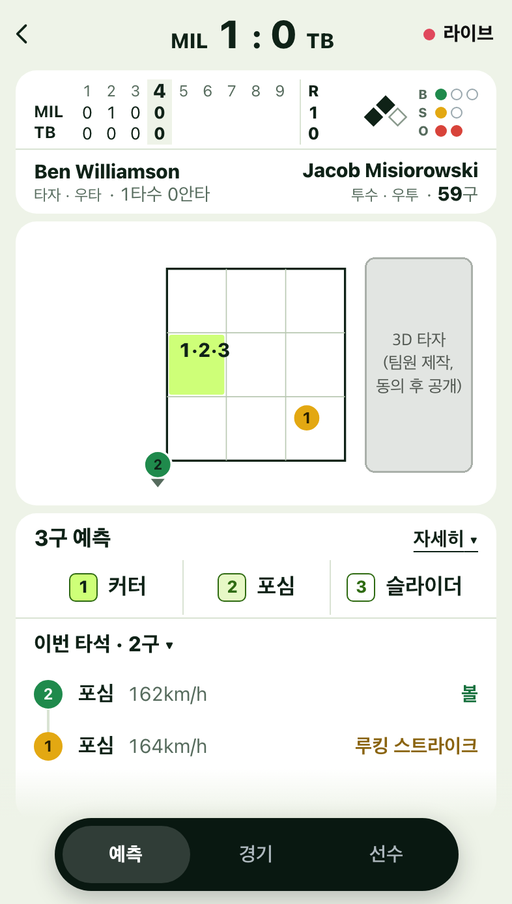
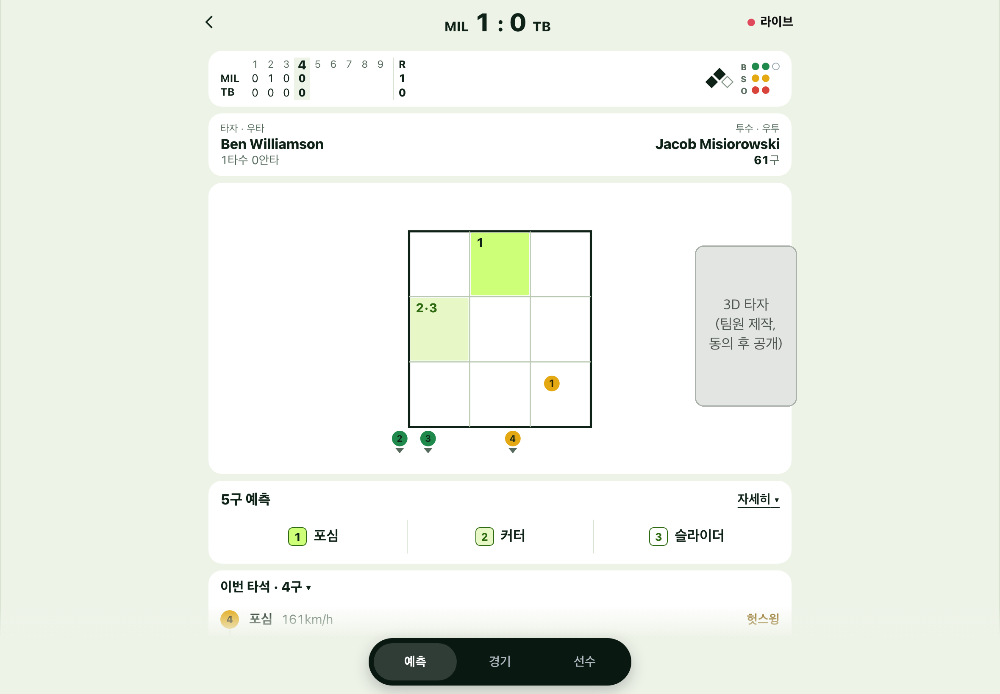
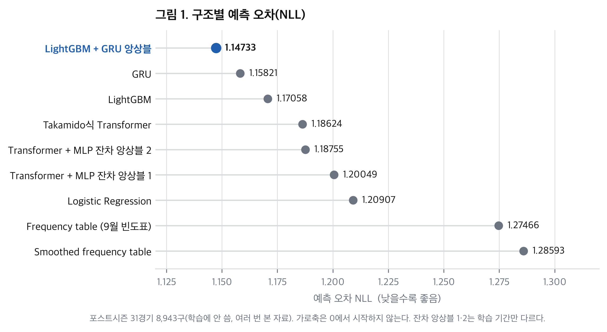
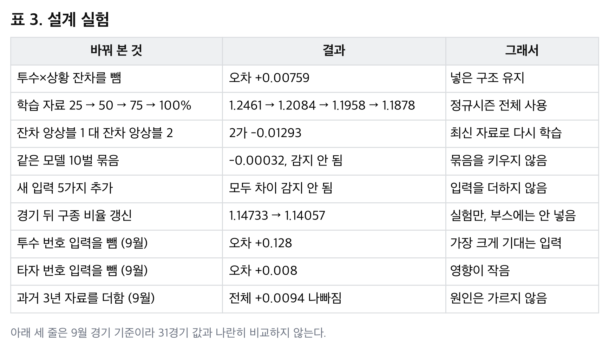

# Pitcheezy — 다음 공의 구종 확률을 보여 주는 야구 관전 화면

> 던지기 전 정보만으로 다음 공의 구종 확률을 내고, 그 예측을 학습에 쓰지 않은 경기로 검증했고, 실제 경기 기록을 받아 화면 파일을 비공개로 발행했습니다.

2026 캡스톤 프로젝트입니다. MLB 공개 투구 기록(Statcast)으로 "다음 공이 어떤 구종일지" 확률을 내는 모델을 만들고, 그 확률을 경기 화면에 보여 주는 관전 서비스를 만들었습니다.

## 결과 숫자 3개

| | 값 | 뜻 |
|---|---|---|
| 예측 오차(NLL) | **1.14733** (9월 빈도표 1.27466) | 2026 포스트시즌 31경기·8,943구. 낮을수록 좋다 |
| 1순위·3순위 적중 | **0.5021 · 0.9081** | 1순위가 맞은 비율 약 2번 중 1번, 3순위 안에 든 비율 약 10번 중 9번 |
| 문헌식 기준 5개 중 가장 좋은 모델(GRU)과의 차이 | **−0.01088 [−0.01436, −0.00748]** | B-SEQ 대비 NLL 차이, 95% 구간이 0 아래 |

- 따로 남겨 둔 와일드카드 8경기에서 한 번만 열어 본 확인 시험에서도 차이는 −0.0059 [−0.0103, −0.0023]였습니다. 8경기 중 7경기에서 우리 모델이 낮았습니다.
- 문헌에서 쓰는 방법을 포함해 9가지 구조를 같은 자료·같은 정보로 직접 다시 만들어 비교했습니다(아래 표). 논문 보고값과 비교한 것이 아닙니다.

## 구조



- 입력은 던지기 전 정보만 씁니다. 볼·스트라이크·아웃, 이닝·점수차·주자, 투수·타자, 같은 경기에서 이 투수가 앞서 던진 공(최대 32개)입니다.
- LightGBM 1개, GRU 5개 묶음, GRU 20개 묶음을 0.15 · 0.30 · 0.55로 섞고 온도 0.94로 다듬어 구종 9가지 확률을 냅니다.
- 서비스 쪽 흐름은 이렇습니다. 맥미니가 MLB 실시간 경기 피드를 받아 상태를 갱신하고, 예측을 계산해 화면 파일로 발행합니다. 폰은 그 파일만 읽습니다.

## 화면

| 폰 | 아이패드 |
|---|---|
|  |  |

- 2026 월드시리즈 5차전을 재생한 화면입니다(11/24 부스 판 rc7).
- 투구 전에 1·2·3순위 구종과 목표 위치를 보여 주고, 이번 타석에서 던진 공을 쌓아 보여 줍니다.
- 오른쪽 회색 상자 자리에는 팀원이 만든 3D 타자가 있습니다. 팀원 동의 전이라 가렸고, 3D 모델 파일과 그 화면 코드는 이 레포에 넣지 않았습니다.

## 자료와 검증 방법

- **자료**
  - MLB Statcast 공개 투구 기록입니다.
  - 학습은 2026 정규시즌으로 했고, 성분 하나는 2023~2025 정규시즌도 썼습니다.
  - 정답은 다음 공의 구종이고, 구종 코드를 9가지로 묶었습니다(포심·싱커·커터·슬라이더·스위퍼·커브·체인지업·스플리터·기타).
- **나눔**
  - 모델 고르기는 9월(DEV)에서만 했습니다.
  - 채점은 학습에 쓰지 않은 2026 포스트시즌 31경기(E_PS)에서 했습니다.
  - 마지막 확인은 아직 채점하지 않은 와일드카드 8경기에서 한 번만 했습니다.
- **비교 기준**: 빈도표, 로지스틱 회귀, LightGBM, GRU, 문헌식 Transformer를 같은 자료·같은 정보로 다시 만들었습니다.
- **차이 구간**: 경기 단위로 다시 뽑기(부트스트랩)를 해서 95% 구간을 냈습니다.
- **운영 규칙**
  - 실험은 실행 전에 등록했고, 작성자와 다른 모델이 검토했습니다.
  - 판정 규칙은 결과를 보기 전에 고정했습니다.

| 구조 | NLL | 1순위 | 3순위 안 |
|---|---|---|---|
| LightGBM + GRU 앙상블 (최종) | 1.14733 | 0.5021 | 0.9081 |
| GRU | 1.15821 | 0.4938 | 0.9085 |
| LightGBM | 1.17058 | 0.4866 | 0.9037 |
| Takamido식 Transformer | 1.18624 | 0.4866 | 0.8998 |
| Transformer + MLP 잔차 앙상블 2 [^cr] | 1.18755 | 0.4986 | 0.9022 |
| Transformer + MLP 잔차 앙상블 1 [^cr] | 1.20049 | 0.4910 | 0.8982 |
| Logistic Regression | 1.20907 | 0.4717 | 0.8968 |
| 빈도표 (9월) | 1.27466 | 0.4405 | 0.8692 |
| 평활 빈도표 | 1.28593 | 0.4340 | 0.8646 |

[^cr]: 잔차 앙상블 1·2를 학습한 코드는 보관 중인 원래 레포에 있고 이 레포에는 없습니다. 이 두 줄은 저장해 둔 예측 확률로 다시 채점한 값입니다.





## 실제 경기 운영

- 2026 월드시리즈 1~5차전 5경기에 실제 경기 기록을 받아 화면 파일을 비공개로 발행했습니다.
  - 발행한 공 수: 263·341·294·367·255구
  - 예측이 뜬 공 수: 180·0·274·301·157구(4경기 912구). 당시 화면 낱말은 "추천"이었습니다.
  - 1차전 빈칸 83구는 대부분 학습 기간 밖 선발 투수였습니다.
  - 2차전은 시작 때 메모리가 문턱에 53 MB 모자라 예측을 끈 채 돌았습니다.
  - 외부 이용자는 없었습니다.
  - 실제 경기에서 돈 것은 이전 추천 정책입니다. 위 표의 최종 모델(v4)은 경기가 끝난 뒤 재생에서만 화면에 나왔습니다.
  - 4경기에서 발행기가 추천을 정하고 짝이 맞은 공 930개 중 413개는 발행기가 그 공의 시작 시각보다 먼저 추천을 정했습니다. 끝 시각 기준으로는 511개입니다. 맥 시계와 MLB 서버 시계를 맞추지 않은 값이고, 화면에 도착한 시각이 아닙니다. 먼저 정해졌다는 것이 팬이 볼 시간이 있었다는 뜻은 아니며, 시계가 1초만 어긋나도 이 개수는 수십 개 달라집니다.
  - 930과 위의 912가 다른 것은 세는 기준이 달라서입니다. 930은 발행기 기록에서 짝이 맞는 추천 수이고, 912는 발행된 화면 파일에서 추천이 떠 있던 공 수입니다.
- 11/24 전시 부스에서는 5차전을 실제 속도로 한 경기 끝까지 재생했습니다.
  - 시간: 11:54:59~15:00:39
  - 경기 종료(14:59:38)까지 한 회차를 재생했습니다. 경보 0, 업로드 실패 0입니다.
  - 전날 밤 같은 설정으로 완주 시험을 했습니다. 공식 판정은 FAIL이었습니다. 판정 대상이 아닌 첫 회차의 표본 하나가 판정 창에 들어간 것이 원인이고, 그 뒤 오류·경보·재시작은 0이었습니다.
  - 그 밤 완주 두 회차(재생)에서는 255구 모두 예측이 그 공의 결과보다 먼저 맥미니 발행 파일에 실렸습니다. 1초 간격으로 잰 발행 파일 시각 기준이고, 공을 던지기 전이라는 뜻도, 화면 도착 시각도 아닙니다.

## 한계

- 31경기는 모델을 고르는 과정에서 여러 번 채점했습니다(탐색·재열람). 그래서 한 번만 연 와일드카드 8경기 확인을 따로 했습니다.
- 검증한 것은 구종 확률입니다. 화면의 목표 위치와 퍼센트 표시는 검증하지 않았습니다.
- 추천대로 던졌을 때의 효과는 −0.12~+0.09%p로 0을 포함합니다. 추천이 도움이 된다는 근거는 없습니다.
- 공개 이용자는 없었습니다. 운영은 비공개 발행과 전시 부스 재생입니다.
- 설문 116명은 지인 단톡방으로 돌린 편의 표본입니다. 무작위 표본이 아닙니다.

## 기여 구분

(팀원과 합의한 뒤 채웁니다.)

## 재현 방법

다시 학습하지 않고, 저장해 둔 공별 예측 확률로 위 9줄 표와 그림을 다시 만드는 경로입니다. 자세한 내용은 [docs/REPRODUCE.md](docs/REPRODUCE.md)에 있습니다.

```bash
pip install -e ".[figures]"
# 1) 저장된 확률과 정답을 data/eps/ 에 둔다 (git에 없음, 아래 참고)
python scripts/export_saved_probs.py --lit-final <LIT-BASE final/> --final-predict <FINAL-v4 predict/> --cr <CR 폴더> --out data/eps
# 2) 다시 채점: 9줄 표 + 경기 단위 부트스트랩 구간 (맥 CPU에서 약 1초)
python scripts/rescore_table.py            # -> results/rescore/table1-rescored.{json,csv}
# 3) 그림·표 다시 그리기 (2의 결과 파일을 읽음)
python scripts/make_structure_figure.py && python scripts/make_figures.py && python scripts/make_onepage.py
```

- 이 레포 작성 때 보관본 확률로 다시 채점해 9줄의 NLL·1순위·3순위가 표와 마지막 자리까지 같았습니다. GRU 대비 차이 −0.01088 [−0.01436, −0.00748]도 같았습니다.
- **이 레포만으로는 재현되지 않는 것**
  - 저장된 확률·정답 라벨은 MLB 경기 자료에서 나온 파생 자료라 넣지 않았습니다([NOTICE](NOTICE)). 정답 라벨은 Statcast에서 직접 받아 만들 수 있지만(방법은 docs/REPRODUCE.md), 모델 확률은 학습을 다시 해야 합니다.
  - 처음부터 다시 학습하는 경로(원자료 → 가공 → 학습 → 선정)는 코드만 있습니다. 가공 자료를 만드는 단계 일부와 GPU 서버에서 돈 학습의 실행 명령은 이 레포에 없고, 장비가 다르면 같은 숫자가 나온다는 보장도 없습니다.
  - 와일드카드 8경기 확인(−0.0059), 실제 경기 운영 숫자, 추천 효과 구간, 설문은 요약만 있고 다시 계산할 입력이 없습니다.
  - 서비스 코드(apps/observer, scripts/svc_pred)는 읽기용입니다. 원래 레포의 다른 모듈과 경기 자료가 있어야 돌아갑니다.

## 저장소 구성

- `experiments/lit_base/`, `scripts/lit_base/`, `configs/` — 기준 모델 5종 재구현, 최종 모델 성분 학습·섞기 선정·채점
- `scripts/rescore_table.py`, `scripts/export_saved_probs.py` — 저장된 확률로 다시 채점
- `scripts/make_*.py` — 그림·표·한 장 요약
- `scripts/v4/` — 최종 모델(v4) 예측·채점 실행 순서
- `scripts/wc8/` — 와일드카드 8경기 1회 확인 코드
- `src/pitcheezy/` — 구종 9가지 정의, 서비스용 예측기
- `scripts/svc_pred/`, `scripts/fan_numbers.py` — 최종 모델을 화면용 예측 파일로 바꾸는 파이프라인
- `apps/observer/backend/` — 경기 피드를 받아 화면 파일을 발행하는 발행기
- `apps/observer/web/` — 폰·태블릿 화면 (Vite + React)
- `results/` — 결과 요약, 다시 채점한 표, 그림
- `docs/` — 재현 방법, 설문 집계, 화면 캡처

## 라이선스

코드는 [MIT](LICENSE)입니다. MLB 자료(Statcast 포함)와 그 파생 자료는 이 라이선스 대상이 아니고 레포에 들어 있지 않습니다([NOTICE](NOTICE)).
