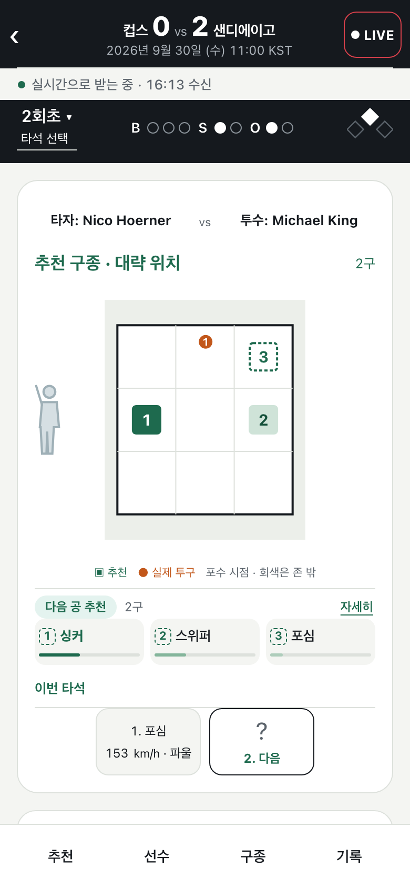

# Pitcheezy

MLB 투구 직전 상황으로 다음 공의 구종·목표 위치 후보를 보여 주는 관전 보조 서비스. 충북대 졸업 캡스톤, 2026-11-24 전시.



## 핵심

| | 내용 |
|---|---|
| 데이터 | Statcast. 학습 2023-05~2025-04, 검증 2025-07~09, 2026은 학습·튜닝·모델 선택에 쓰지 않음 |
| 예측 | 다음 공 결과 10클래스 확률. 검증 구간 311,721구에서 log loss 1.4904 vs 상황 빈도 기준선 1.5041, 5/5 시드 개선 ([근거](results/EXP-P11-001.json)) |
| 추천 | 2026 시즌 2,429경기 오프폴리시 평가에서 개선 근거 없음 → 화면에 "검증 전 실험"으로 표시 |
| 실시간 | MLB StatsAPI 피드 → FastAPI → React, 추천이 투구 전 계산인지 사후 재생인지 배지로 구분 |

```
Statcast 수집 → 전처리·특징 → 학습·동결 → 추론(사전/실시간) → FastAPI → React
```

## 내 역할

방향 설정, 실험 설계, ML 모델(전이 확률·추천 정책). 구현·검사는 AI 코딩 에이전트와 나누고, 작성자와 다른 에이전트의 검토를 거쳐 병합.

## 팀원용

1. [30~60분 온보딩](docs/onboarding.md): 데이터·모델 없이 실행하는 첫 CPU 검사.
2. [프로젝트 지도](docs/pm/project-map.md): 코드와 문서의 역할.
3. [PM 운영 안내](docs/pm/overview.md): 현재 상태·담당자·업무 절차·자원 진입점.
4. [11/24 전시 방향](docs/handoffs/CODEX-resume-2026-10-31.md): UI-1026·849843 재생·모니터 두 대·폰 QR 구성과 현재 할 일.

전시 기능 동결 목표는 11/20, 리허설은 11/21~23이다. 저장 재생을 실시간 서비스 완료로 보지 않는다. 현재 실행 사실은 [통합 상태](docs/pm/integration/state.md)의 시각·근거를 확인한다. 에이전트 지침 정본은 [AGENTS](AGENTS.md)이며 CLAUDE도 이를 import한다. 역할 인계는 [협업 안내](docs/AI_COLLABORATION.md)를 따른다.

소유: 통합 문서 담당 · 갱신: 진입점 변경 시 · 마지막 확인: 2026-11-02.
